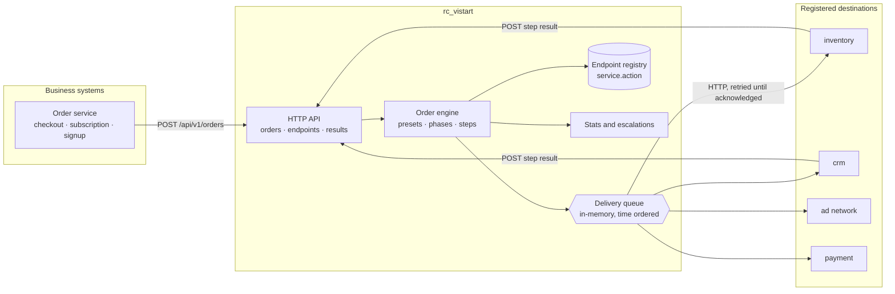
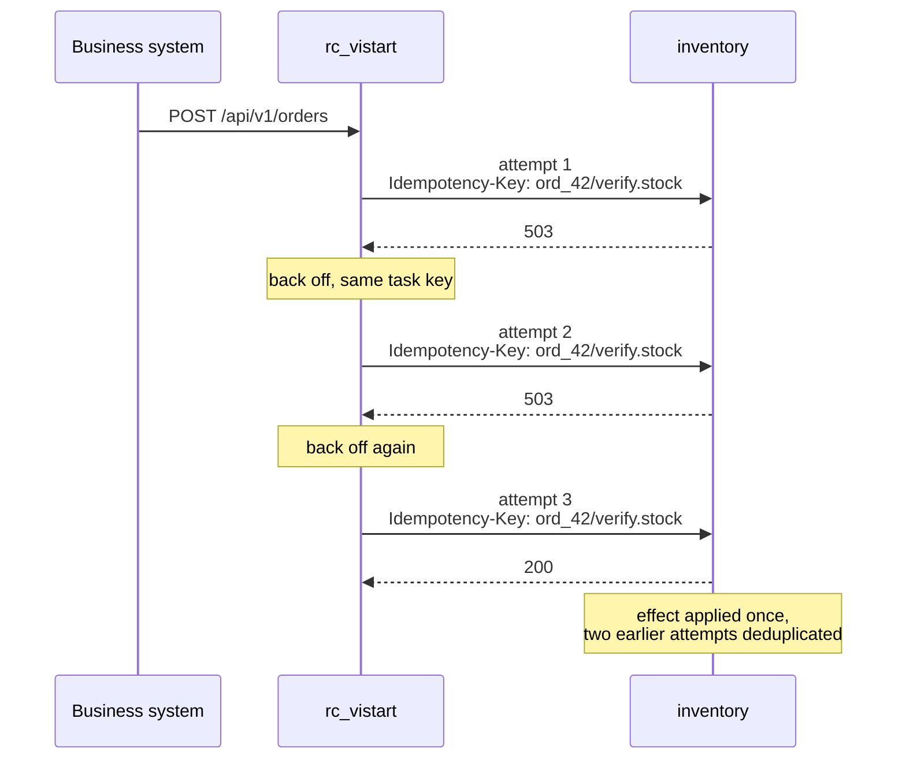
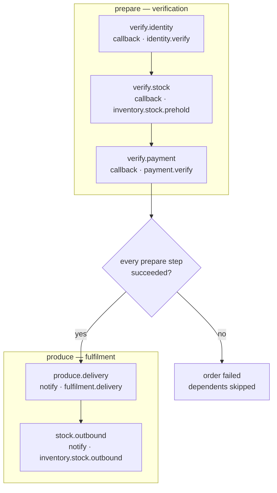
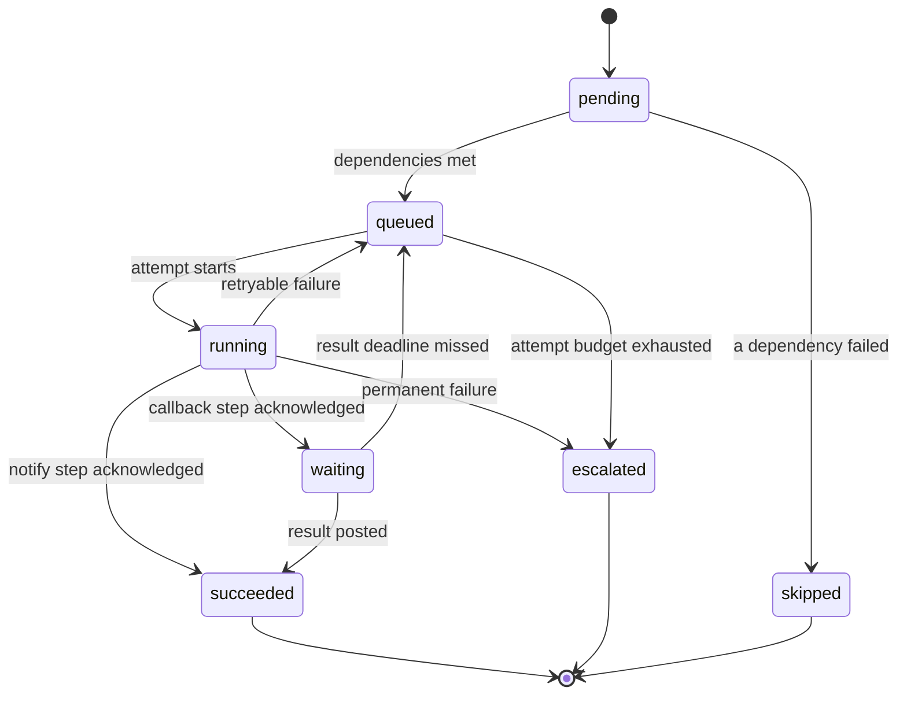
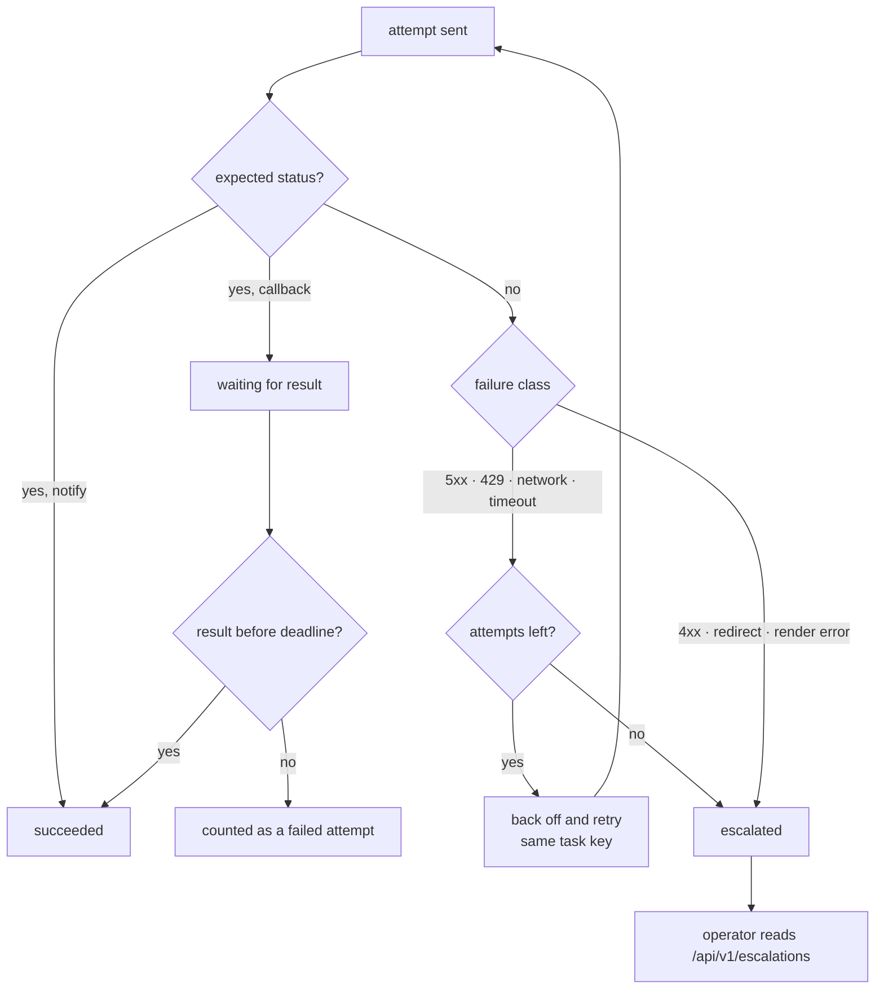

# rc_vistart

> **TODO — project description.** This section is a placeholder and will be
> replaced with the official introduction once it is provided.

An internal delivery service. Business systems submit orders to it; it notifies
the downstream endpoints those systems registered, and keeps trying until each
notification is acknowledged.

- **Accepts** order submissions over a small JSON HTTP API.
- **Delivers** each step of an order to the destination registered for it,
  retrying with backoff and escalating whatever never lands.
- **Tracks** every attempt, so "did we send it?" and "did we send it twice?"
  are both answerable after the fact.

No third-party dependencies — only the Go standard library.

## Contents

- [Demo scenarios](#demo-scenarios)
- [Architecture](#architecture)
- [The delivery guarantee](#the-delivery-guarantee)
- [Orders and steps](#orders-and-steps)
- [Registering a destination](#registering-a-destination)
- [HTTP API](#http-api)
- [Retries and escalation](#retries-and-escalation)
- [Monitoring](#monitoring)
- [Configuration](#configuration)
- [Running the service by hand](#running-the-service-by-hand)
- [Development](#development)
- [Prototype limitations](#prototype-limitations)

## Demo scenarios

`make demo` starts a real service and real simulated destinations, drives the
typical situations, and prints what happened at each step.

```bash
make demo           # every scenario
make demo-list      # what is available
make demo-retry     # just one
make demo-verbose   # with the service log
```

Each scenario **asserts its expectations**, so the command exits non-zero if
anything misbehaves. The demos are an end-to-end check, not decoration — the
same scenarios also run under `go test ./...`.

| Target                | Scenario                                             | Shows                                             |
| --------------------- | ---------------------------------------------------- | -------------------------------------------------- |
| `make demo-order`     | Standard order                                       | The phase gate: checks first, then fulfilment.     |
| `make demo-simple`    | Ad registration, CRM contact                         | The single-notification business cases.            |
| `make demo-retry`     | Destination rejects two attempts, then accepts       | Retry without duplicating the effect.              |
| `make demo-silent`    | Destination answers 200 but never reports a result   | "We never heard back" becomes a retry, then an escalation. |
| `make demo-permanent` | Destination rejects with 400                         | A wrong request is not retried.                    |
| `make demo-missing`   | Nothing registered for the topic                     | A missing destination stops the order cleanly.     |

The retry scenario is the one worth reading. The destination is told to reject
the first two attempts and accept the third:

```
1/6  retry     Retry without duplicating the effect
------------------------------------------------------------------------
  The destination rejects the first two attempts and accepts the third. rc_vistart backs
  off and tries again, so one task produces three notifications. Because the task key is
  stable across retries, the destination applies the business effect exactly once.

  [ok  ] order state = succeeded, want succeeded
  [ok  ] delivery attempts = 3, want 3
  [ok  ] notifications received = 3, want 3
  [ok  ] business effects applied = 1, want 1
  [ok  ] ledger entries = 3, want 3

  step  phase    kind    state      attempts  notified  applied  last outcome
  ship  prepare  notify  succeeded  3         3         1        http 200

  PASS  retry (315ms)
```

Three notifications, one applied effect. That is the whole anti-duplication
argument in one line of output.

Scenarios run entirely in-process on ephemeral ports, so they need no setup and
leave nothing behind.

## Architecture



Four moving parts, each with one job:

| Part                | Responsibility                                                      |
| ------------------- | ------------------------------------------------------------------- |
| `internal/httpapi`  | HTTP surface. Knows nothing about delivery.                         |
| `internal/order`    | Order graph, phases, step state machine, escalation.                |
| `internal/notify`   | Endpoint registry, template rendering, HTTP invocation, queue, stats. |
| `internal/config`   | Environment parsing and validation.                                 |

The delivery engine does not know about orders, and the order engine does not
speak HTTP. They meet only where the engine performs a delivery.

`internal/mockservice` and `internal/demo` exist for the demos and for manual
testing; nothing in the service depends on them.

## The delivery guarantee

Exactly-once delivery is not achievable over HTTP: a destination that crashes
after acting but before answering leaves the sender unable to tell "done" from
"never arrived". `rc_vistart` therefore guarantees **at-least-once delivery per
task**, paired with two things that make it safe.

**1. A task key that survives retries.** Every step has the stable identity
`<order id>/<step name>`, sent as `X-Rc-Vistart-Idempotency-Key`. It does not
change across retries, so a destination can tell a retry from new work. The
per-attempt `X-Rc-Vistart-Delivery` id exists only for tracing.

**2. An audit trail.** Every attempt is recorded in the step's ledger, so a
dropped or repeated notification is visible rather than silent.



> **Both sides are responsible.** `rc_vistart` retries until acknowledged, and
> retries a step whose *result* never arrives. The destination must deduplicate
> on the task key. `internal/mockservice` shows the pattern, and the `retry`
> demo proves it.

Losing a notification is treated as the worse failure, because a duplicate
notice is recoverable downstream and a dropped one is not.

## Orders and steps

An order is a fixed graph of steps, created once and never mutated. Each step is
one task with its own identity.



Two kinds of step:

| Kind        | Finished when                                                  |
| ----------- | -------------------------------------------------------------- |
| `notify`    | The destination answers with an expected status code.          |
| `callback`  | The destination *also* posts a result to the URL it was given. |

`callback` exists because a `200` only means the request was understood. Stock
pre-deduction needs to know whether stock was actually reserved, so the step
waits for an answer — and if the answer never comes, the step is retried, then
escalated.

Dependencies stay **inside** a phase. Moving to the next phase is what gates it,
which is why `produce.delivery` declares no dependency on the checks: it cannot
run until prepare has fully succeeded. An order with no produce steps finishes
when its only phase does.



`skipped` is what keeps a broken graph from hanging: a step whose dependency
failed is retired immediately rather than left waiting forever.

### Presets

| Preset            | Steps                                                      |
| ----------------- | ---------------------------------------------------------- |
| `order.standard`  | Identity, stock pre-deduction, payment → delivery, outbound |
| `ad.registration` | Notify the ad network that a registration succeeded         |
| `crm.contact`     | Move a CRM contact to a new status                          |

`GET /api/v1/presets` returns them as JSON. A caller may pass a preset, supply
its own step graph, or take the standard order by default.

## Registering a destination

Each destination registers itself. Re-registering the same topic replaces the
previous registration and keeps the id, so a service can rotate its URL without
creating a second destination for one task.

```bash
curl -X POST http://localhost:8080/api/v1/endpoints \
  -H 'Content-Type: application/json' \
  -d '{
        "service": "inventory",
        "action":  "stock.prehold",
        "method":  "POST",
        "url":     "https://inventory.internal/hooks/prehold",
        "headers": [{"name": "X-Api-Key", "value": "{{ .secret }}"}],
        "body":    "{\"order\":\"{{ .order.id }}\",\"items\":{{ json .items }}}",
        "expect_status": [200, 202],
        "timeout": "3s",
        "result_timeout": "30s",
        "max_attempts": 5,
        "backoff_base": "500ms",
        "backoff_max": "30s"
      }'
```

| Field             | Meaning                                                    |
| ----------------- | ---------------------------------------------------------- |
| `service`, `action` | The topic is `<service>.<action>`, e.g. `inventory.stock.prehold`. |
| `method`          | `POST`, `PUT` or `PATCH`.                                  |
| `url`             | Templated target URL.                                      |
| `headers`, `body` | Templated request headers and body.                        |
| `expect_status`   | Status codes that count as an acknowledgement.             |
| `timeout`         | Deadline for one attempt, including the wait for a response. |
| `result_timeout`  | How long a `callback` step waits for its result.           |
| `max_attempts`    | Attempts before the task is escalated.                     |
| `backoff_*`       | Exponential retry delay bounds.                            |
| `secret`          | Shared key exposed to templates as `.secret`.              |

Registration validates everything up front: templates are parsed, rendered
against sample data, and checked for references that could never resolve. A
registration that cannot work is rejected with `400` rather than failing on the
third retry of a live order.

### Template context

| Reference             | Value                                                |
| --------------------- | ---------------------------------------------------- |
| `.order.id`           | Order id.                                            |
| `.order.external_ref` | The caller's own reference.                          |
| `.order.subject`      | Subject of the order.                                |
| `.order.phase`        | `prepare` or `produce`.                              |
| `.step.name`          | Step name.                                           |
| `.step.attempt`       | Attempt number, starting at 1.                       |
| `.step.topic`         | Topic being delivered to.                            |
| `.items`              | List of `{sku, name, quantity, price}`.              |
| `.payload`            | The caller-supplied payload.                         |
| `.idempotency_key`    | The stable task key.                                 |
| `.delivery_id`        | This attempt's id; differs per attempt, for tracing. |
| `.result_url`         | Where to post a result for a `callback` step.        |
| `.secret`             | The registration's shared secret.                    |
| `.timestamp`, `.unix` | Send time, RFC 3339 and Unix seconds.                |
| `.body`               | The rendered body. **Header templates only.**        |
| `.signature`          | `HMAC-SHA256(secret, "<unix>.<body>")`. **Headers only.** |

Helpers: `json`, `urlquery`, `hmacSHA256`, `default`, `upper`, `lower`, `trim`.


The URL and body render first, then the headers — so a header can sign the body,
which is what reproducing a destination's own signing scheme requires. For the
same reason `.signature` and `.body` are rejected inside the URL and body: the
signature covers the body, so it cannot appear within it.

An absent key in `.payload` fails the delivery rather than sending a blank field
to a destination. Use `{{ default "x" (index .payload "maybe") }}` for an
optional value.

## HTTP API

| Method   | Path                                      | Purpose                            |
| -------- | ----------------------------------------- | ---------------------------------- |
| `GET`    | `/healthz`                                | Liveness probe.                    |
| `POST`   | `/api/v1/endpoints`                       | Register a destination.            |
| `GET`    | `/api/v1/endpoints`                       | List registrations.                |
| `DELETE` | `/api/v1/endpoints/{topic}`               | Remove a registration.             |
| `GET`    | `/api/v1/presets`                         | Built-in step graphs.              |
| `POST`   | `/api/v1/orders`                          | Submit an order.                   |
| `GET`    | `/api/v1/orders`                          | List orders, optionally `?state=`. |
| `GET`    | `/api/v1/orders/{id}`                     | Inspect an order and its ledger.   |
| `POST`   | `/api/v1/orders/{id}/steps/{step}/result` | Post a step result.                |
| `GET`    | `/api/v1/stats`                           | Per-destination delivery statistics. |
| `GET`    | `/api/v1/escalations`                     | Tasks needing a human.             |

### Submitting an order

```bash
curl -X POST http://localhost:8080/api/v1/orders \
  -H 'Content-Type: application/json' \
  -d '{"external_ref":"BIZ-2026-0042","subject":"user-42",
       "items":[{"sku":"SKU-1","quantity":2,"price":19.9}],
       "payload":{"channel":"app"}}'
```

Omit `preset` for the standard order, name one, or send your own `steps`.

### Reporting a result

```bash
curl -X POST http://localhost:8080/api/v1/orders/$ORDER/steps/verify.stock/result \
  -H 'Content-Type: application/json' \
  -d '{"delivery_id":"'$DELIVERY'","success":true,"data":{"reserved":2}}'
```

`delivery_id` must echo the `X-Rc-Vistart-Delivery` header of the delivery being
answered, which is how a late or forged answer is rejected. Reposting is
harmless: a step that already finished ignores it rather than transitioning
twice.

`success: false` is a business rejection, not a transport failure, so it
escalates immediately instead of burning the retry budget.

### Errors

```json
{
  "error": "invalid_registration",
  "message": "notify: invalid endpoint: body: .signature covers the body itself, so it is only available to header templates"
}
```

`error` is a stable code (`invalid_request`, `invalid_registration`,
`invalid_order`, `not_found`, `conflict`, `internal_error`); `message` is for
humans.

## Retries and escalation



| Failure                                 | Retried?                                   |
| --------------------------------------- | ------------------------------------------ |
| Network error, timeout, `5xx`, `429`    | Yes, with exponential backoff.             |
| No result within `result_timeout`       | Yes — this is "we never heard back".       |
| `4xx`, redirect, unrenderable template  | No. Retrying cannot fix a wrong request.   |
| No endpoint registered for the topic    | Yes, then escalated. It may register late. |

After the budget is spent the step becomes `escalated`, the order fails, and the
task is listed in `/api/v1/escalations`. Dependent steps are `skipped` rather
than left pending.

Every attempt appears in the step's ledger with its status code, latency and
error, so "three attempts, one of which was 503 at 14:02:11" is answerable
afterwards.

## Monitoring

```bash
curl http://localhost:8080/api/v1/stats
```

Reports `attempts`, `delivered`, `failed`, `escalated` and mean latency per
topic. Escalation is additionally logged at `ERROR` with the task key, which is
the hook a real deployment would page from.

## Configuration

| Variable                                 | Default                 | Meaning                             |
| ---------------------------------------- | ----------------------- | ----------------------------------- |
| `RC_VISTART_ADDR`                        | `:8080`                 | Listen address.                     |
| `RC_VISTART_PUBLIC_URL`                  | `http://localhost:8080` | Base URL destinations post results to. |
| `RC_VISTART_WORKERS`                     | `8`                     | Concurrent delivery attempts.       |
| `RC_VISTART_POLL_INTERVAL`               | `50ms`                  | Idle worker re-check interval.      |
| `RC_VISTART_READ_TIMEOUT`                | `5s`                    | Read deadline per request.          |
| `RC_VISTART_WRITE_TIMEOUT`               | `10s`                   | Write deadline per response.        |
| `RC_VISTART_IDLE_TIMEOUT`                | `60s`                   | Idle keep-alive timeout.            |
| `RC_VISTART_SHUTDOWN_TIMEOUT`            | `15s`                   | Grace period on SIGINT/SIGTERM.     |
| `RC_VISTART_MAX_BODY_BYTES`              | `1048576`               | Maximum request body.               |
| `RC_VISTART_MAX_CALLBACK_RESPONSE_BYTES` | `65536`                 | Response bytes read per delivery.   |
| `RC_VISTART_LOG_LEVEL`                   | `info`                  | `debug`, `info`, `warn`, `error`.   |
| `RC_VISTART_LOG_FORMAT`                  | `json`                  | `json` or `text`.                   |

> **`RC_VISTART_PUBLIC_URL` matters.** Destinations are told where to post
> results through it. If it is unreachable from their network, every `callback`
> step will time out and be retried.

`rc_vistart` shuts down gracefully on `SIGINT`/`SIGTERM`, letting in-flight
deliveries finish within the grace period.

## Running the service by hand

The demos cover the automated path. For manual work, run the service and a mock
destination:

```bash
make run                                              # rc_vistart on :8080
make mock ARGS="-service inventory -action stock.prehold"   # a destination on :9001
```

`mock_service` flags make the reliability paths easy to poke at by hand:

| Flag                       | Demonstrates                                      |
| -------------------------- | ------------------------------------------------- |
| `-fail-first N`            | Retry, then success                               |
| `-fail-status 400`         | A permanent failure, not retried                  |
| `-fail-forever`            | Escalation once the budget is spent               |
| `-silent`                  | Acknowledged but no result → result-timeout retry |
| `-result-timeout`, `-max-attempts`, `-backoff-*` | The timing knobs |

Inspect what a destination actually received:

```bash
curl http://localhost:9001/state
```

## Development

There is no remote CI for this project — verification is local.

```bash
make check   # gofmt check, go vet, tests
make test    # go test ./...
make cover   # coverage.out + coverage.html
make build   # bin/rc_vistart, bin/mock_service, bin/demo
make help    # list every target
```

Without `make` (or on Windows, where `make` may not be installed):

```bash
gofmt -s -l . && go vet ./... && go test ./...
go run ./cmd/demo
go build -o bin/rc_vistart.exe ./cmd/rc_vistart
```

> **Note on `-race`:** `make test-race` runs `go test -race ./...`, which needs a
> working race-enabled toolchain (CGO plus a supported C compiler). On the
> current Windows/mingw setup it fails to start with an entry-point error before
> any test runs, so treat it as optional until the toolchain is fixed.

## Project layout

```
cmd/rc_vistart/       Service entry point, wiring and graceful shutdown
cmd/mock_service/     CLI around internal/mockservice
cmd/demo/             Demo runner: reports, and exits non-zero on failure
internal/notify/      Endpoint registry, templates, HTTP invoker, queue, stats
internal/order/       Order model, presets and the orchestration engine
internal/httpapi/     Routing and request/response handling
internal/mockservice/ Simulated destination, shared by the demo and the CLI
internal/demo/        Scenario definitions and the harness they run in
internal/config/      Environment-based configuration
internal/version/     Build metadata injected via -ldflags
```

## Prototype limitations

Stated plainly, because the design is otherwise easy to over-read:

- **State is in memory.** Endpoint registrations, orders and the queue are lost
  on restart. A production version needs durable storage for all three; the
  `notify.Registry` interface and the engine's order store are where it would
  plug in.
- **The step result endpoint is unauthenticated** beyond matching the delivery
  id. A real deployment needs per-service credentials or mTLS.
- **Escalation is a log line and an API view**, not a page.
- **The queue is a sorted slice**, fine for thousands of pending tasks, not
  millions.
- **`rc_vistart` does not resume interrupted deliveries** after a restart, which
  follows from the first point.
- **Deduplication is the destination's job.** The service makes it possible by
  keeping the task key stable; it cannot enforce it.

## License

[MIT](LICENSE) © 2026 vistart