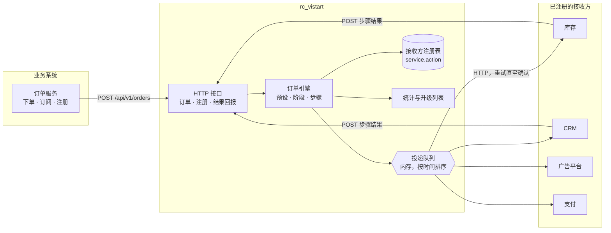
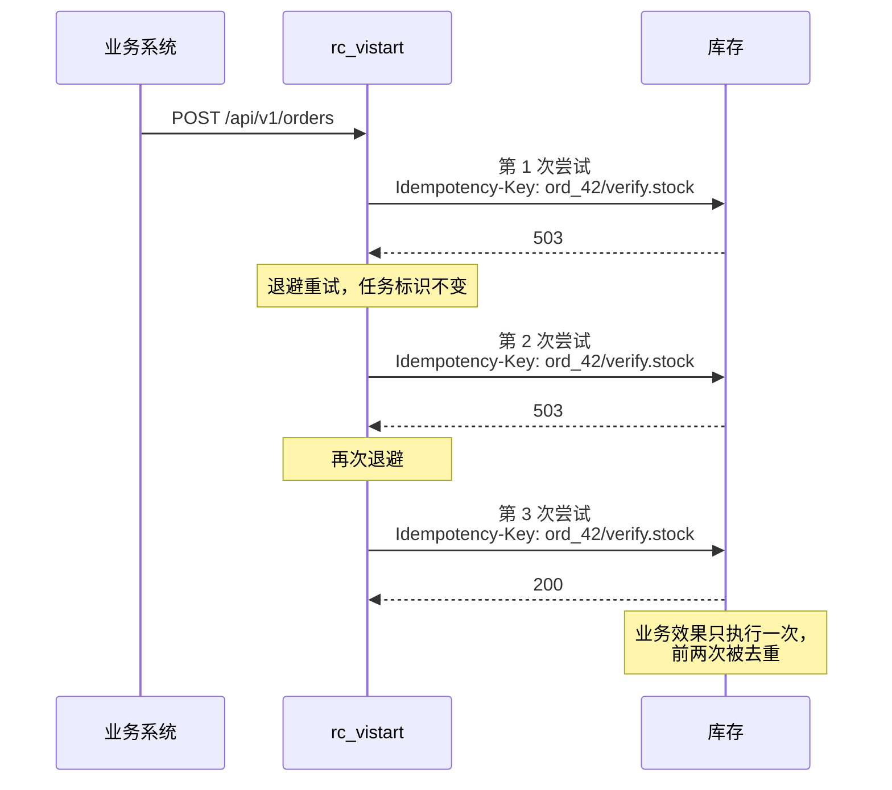
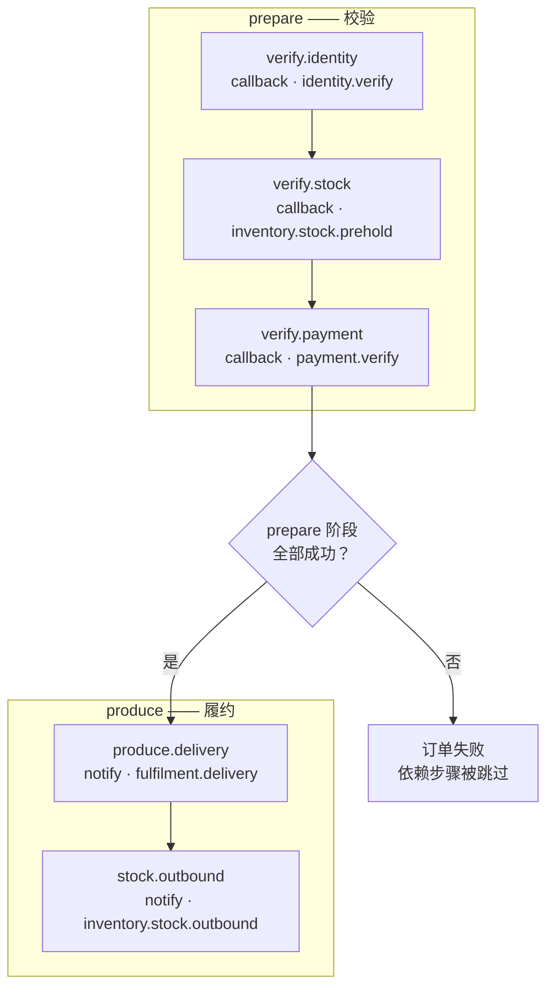
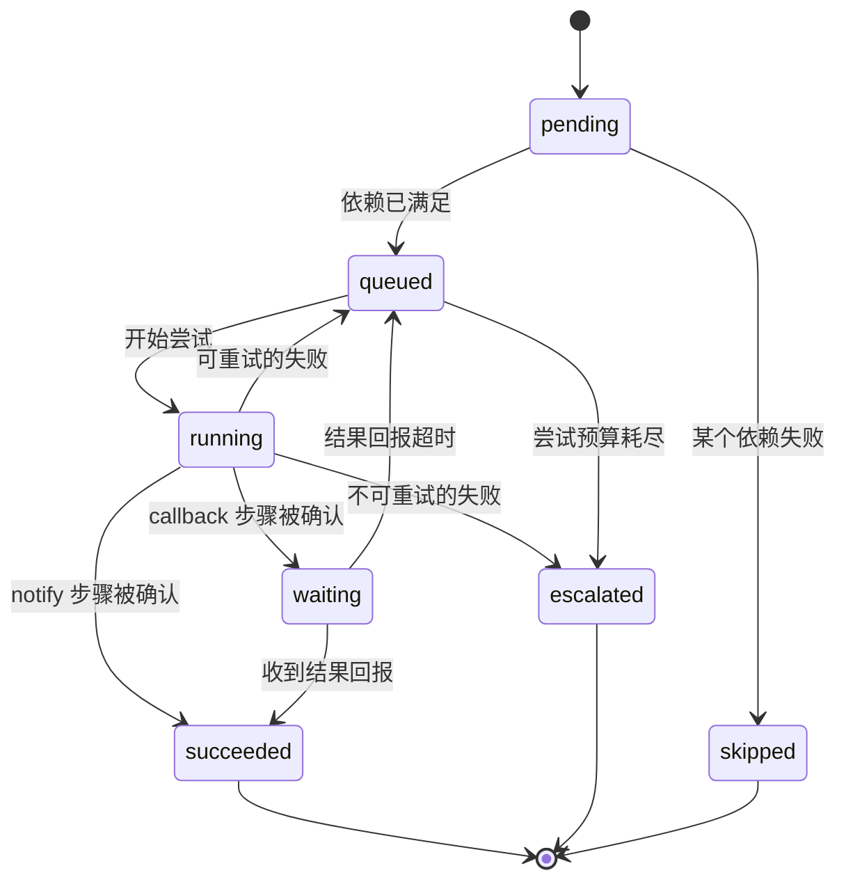
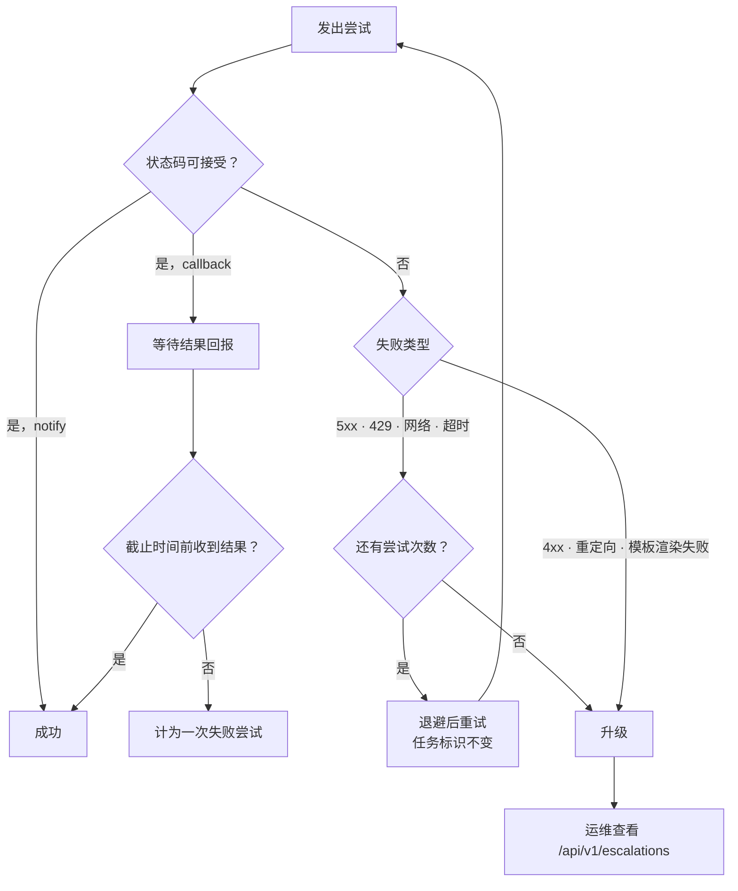

# rc_vistart

[English](README.md) | [简体中文](README.zh-cn.md)

[](https://github.com/vistart/rc_vistart/actions/workflows/ci.yml)

一个面向订单驱动的内部通知投递服务。

业务系统提交订单；`rc_vistart` 把订单中的每一个步骤投递到对应注册的接收方，
一直重试直到被确认，并将始终无法送达的任务升级告警。

它存在的原因，是各个接收方彼此不一致：广告平台、CRM、库存与支付，各有不同的请求
地址、不同的 HTTP 方法、不同的 Header 与不同的 Body 结构，并且各自认定成功的标准
也不相同。这些差异不属于业务系统；而如果在每个业务系统里各写一套投递逻辑，就意味
着要在四个地方同时维护，且没有任何一处会发现通知被悄悄丢掉。

因此：由接收方注册自己希望被如何调用，业务系统只负责提交订单。

- **接收**订单（一个简洁的 JSON HTTP API），可使用内置场景，也可自定义步骤图。
- **投递**每个步骤至少一次，支持按接收方配置超时、可接受状态码、指数退避与升级。
- **记录**每一次尝试并形成台账，因此事后可回答"发出去了吗？"与"发了几次？"。

无第三方依赖，只使用 Go 标准库。至于它刻意*不*做的事，见[设计取舍](#设计取舍)。

## 目录

- [演示场景](#演示场景)
- [架构设计](#架构设计)
- [投递语义保证](#投递语义保证)
- [设计取舍](#设计取舍)
  - [系统边界](#系统边界)
  - [可靠性与失败处理](#可靠性与失败处理)
  - [取舍与演进](#取舍与演进)
- [订单与步骤](#订单与步骤)
- [注册接收方](#注册接收方)
- [HTTP 接口](#http-接口)
- [重试与升级](#重试与升级)
- [监控](#监控)
- [配置](#配置)
- [手动运行](#手动运行)
- [开发](#开发)
- [原型阶段的局限](#原型阶段的局限)

## 演示场景

`make demo` 会启动一个真实的服务和真实的模拟接收方，跑完典型场景，并打印每一步
发生了什么。

```bash
make demo           # 全部场景
make demo-list      # 查看有哪些场景
make demo-retry     # 只跑一个
make demo-verbose   # 附带服务日志
```

每个场景都会**校验自己的预期结果**，任何一项不符合预期，命令就以非零码退出。因此
演示同时是一次端到端验证，而不是走过场 —— 同样的场景也会在 `go test ./...` 中执行。

| 目标                  | 场景                                   | 展示内容                                             |
| --------------------- | -------------------------------------- | ---------------------------------------------------- |
| `make demo-order`     | 标准下单                               | 阶段闸门：先校验，再履约。                           |
| `make demo-simple`    | 广告注册、CRM 联系人                  | 两类单次通知型业务。                                  |
| `make demo-retry`     | 接收方前两次拒绝、第三次接受           | 重试但业务效果不重复。                                |
| `make demo-silent`    | 接收方返回 200 但从不回报结果          | "一直没等到回应"如何变成重试，最终升级。             |
| `make demo-permanent` | 接收方以 400 拒绝                      | 错误的请求不会被重试。                                |
| `make demo-missing`   | 该 topic 无人注册                      | 缺失的接收方如何干净地终止订单。                      |

最值得看的是重试场景。接收方被要求前两次拒绝、第三次接受：

```
1/6  retry     Retry without duplicating the effect
------------------------------------------------------------------------
  The destination rejects the first two attempts and accepts the third. rc_vistart backs
  off and tries again, so one task produces three notifications. Because the task key is
  stable across retries, the destination applies the business effect exactly once.

  [ok  ] order state = succeeded, want succeeded
  [ok  ] delivery attempts = 3, want 3
  [ok  ] notifications received = 3, want 3
  [ok  ] business effects applied = 1, want 1
  [ok  ] ledger entries = 3, want 3

  step  phase    kind    state      attempts  notified  applied  last outcome
  ship  prepare  notify  succeeded  3         3         1        http 200

  PASS  retry (315ms)
```

三条通知，一次业务效果。整个防重论证就在这一行输出里。

所有场景都在进程内、使用临时端口运行，因此不需要任何准备，也不会留下残留。

## 架构设计



四个部件，各自职责单一：

| 部件                  | 职责                                                       |
| --------------------- | ---------------------------------------------------------- |
| `internal/httpapi`    | HTTP 接口层，不了解投递细节。                              |
| `internal/order`      | 订单图、阶段、步骤状态机、升级。                          |
| `internal/notify`     | 接收方注册、模板渲染、HTTP 调用、队列、统计。              |
| `internal/config`     | 环境变量解析与校验。                                       |

投递引擎不知道订单的存在，订单引擎也不会说 HTTP。两者只在"引擎执行一次投递"这
一个地方交汇。

`internal/mockservice` 和 `internal/demo` 只服务于演示与手工验证，服务本身不依赖它们。

## 投递语义保证

HTTP 无法实现"恰好一次"投递：接收方在完成业务动作之后、返回响应之前崩溃，发送方
无法区分"已经做完"和"从未收到"。因此 `rc_vistart` 保证的是**每个任务至少一次投递**，
并配套两件事使其安全。

**其一，跨重试保持不变的任务标识。** 每个步骤都有稳定标识
`<订单 ID>/<步骤名>`，通过 `X-Rc-Vistart-Idempotency-Key` 发送。它在多次重试之间保持
不变，因此接收方可以区分"这是一次重试"和"这是一笔新任务"。每次尝试独有的
`X-Rc-Vistart-Delivery` 仅用于链路追踪。

**其二，可审计的投递记录。** 每一次尝试都记入该步骤的投递台账，因此通知的丢失或
重复是可见的，而不是悄无声息。



> **需要双方配合。** `rc_vistart` 会一直重试直到收到确认，也会在步骤*结果*始终未回
> 达时重试。接收方必须基于任务标识做幂等去重。`internal/mockservice` 展示了这一做法，
> `retry` 场景对它做了验证。

我们把"丢通知"视为更严重的故障：重复通知下游还能补救，丢失则不能。

## 设计取舍

本章说明系统的推理过程：它负责什么、刻意不负责什么，以及规模增长后需要改变什么。

### 系统边界

**本系统承担的责任：**

- 接收订单，并持有其步骤图；步骤图在创建时固定。
- 将每个步骤至少一次地投递到对应注册的接收方。
- 判断步骤何时完成 —— 收到确认，或收到回报结果。
- 对可重试的失败进行重试，对无法送达的任务进行升级。
- 记录每一次尝试，使通知的丢失或重复可见。
- 按接收方塑形请求，因为 URL、Header、Body 各不相同。

**本系统明确不做的事，以及原因：**

| 不解决的问题           | 原因                                                                                                                             |
| --------------------- | -------------------------------------------------------------------------------------------------------------------------------- |
| 业务真相              | `rc_vistart` 并不知道库存是否存在，只知道接收方是否如此回答。业务规则属于业务服务；在此重复实现会造成第二个事实来源，并悄然产生分歧。 |
| 接收方侧去重          | 只有接收方才能在不信任发送方的前提下区分"重试"与"新任务"。我们提供稳定的任务标识，从而使去重成为可能，但无法强制它。            |
| 恰好一次投递          | 在没有分布式事务的前提下无法实现。宣称具备只会掩盖问题，而不是解决问题。                                                          |
| 接收方的可用性        | 我们负责重试与升级，但不负责让下游变健康。那是接收方自己的职责。                                                                  |
| 厂商协议的模型转换    | 模板让每个接收方自行拥有自己的请求格式。集中式的映射层会把所有第三方协议都搬进本仓库。                                            |
| 向多个接收方广播      | 一个 topic 只对应一个接收方。如果某一方需要在三个地方收到同一事件，就建模为三个步骤，这样投递与统计仍然是按接收方独立的。        |
| 长期历史留存          | 这里的订单是运行期记录，不是数据仓库。留存与分析应当放在别处。                                                                    |
| 服务间认证            | 结果回报接口仅校验投递 ID，不做身份认证。这是原型阶段有意的简化，也是上线前第一件要修的事。                                          |

### 可靠性与失败处理

**投递语义：每个任务至少一次，辅以稳定的任务标识与接收方侧去重。**

- 不是**至多一次**：丢失通知属于不可恢复的业务损失，而重复在下游是可补救的。
  这个不对称决定了取舍。
- 不是**恰好一次**：HTTP 无法提供分布式事务。它可以借助"去重 + 两阶段握手"来
  *逼近*，但那是一个大得多的系统，而且仍然不是保证。

**在做任何重试之前先对失败分类**，因为重试一个注定失败的请求只会浪费时间并掩盖真实
错误：

| 失败类型                       | 处理方式                                                        |
| ------------------------------ | --------------------------------------------------------------- |
| 网络错误、超时、`5xx`、`429`   | 按指数退避重试，直到 `max_attempts`。                           |
| 在截止时间内未回报结果         | 计为一次失败尝试并重试。这就是"一直没等到回应"。               |
| `4xx`、重定向                  | 立即升级。请求本身就是错的，再发一次还是错的。                  |
| 模板无法渲染                   | 立即升级，并且注册阶段就已拒绝这类模板。                        |
| 该 topic 尚无注册方            | 先重试再升级，因为接收方可能稍后才注册。                        |

**当外部系统失败或长期不可用时：**

1. 每个接收方各自拥有独立的尝试预算与退避上限，因此一个接收方的行为不会影响另一个。
2. 预算耗尽后步骤变为 `escalated`，订单失败，依赖步骤被 `skipped` —— 绝不留下悬挂。
3. 该任务出现在 `/api/v1/escalations`，并以 `ERROR` 级别连同任务标识记录日志。
   这个列表就是运维的工作队列。
4. 接收方可以在任何时候通过重新注册恢复：注册会就地替换该接收方并保留其 ID，
   因此后续订单可自动恢复正常，无需人工干预。

需要如实指出的缺口：**升级后的任务不会在接收方恢复时自动重放。** 目前需要人工处理
升级列表。如果某个接收方宕机一小时，该时间窗内的每一笔订单都会升级，每一笔都需要
人工处理。按 topic 与时间窗自动重放是最可能的下一步功能 —— 任务标识保证了重放的
安全性，因为接收方会把重复投递去重掉。

**无法防护的情况：** 进程崩溃导致进行中的工作丢失，因为没有任何持久化；以及时钟
偏移，因为重放窗口由接收方依据我们发送的时间戳自行判断。

### 取舍与演进

**在当前阶段被判定为过度设计而未采纳的方案。** 以下每一条在生产环境下都是站得住脚
的做法，但对一个尚无实测负载的原型而言，代价大于收益：

- **引入 Kafka 之类的消息中间件。** 我们确实需要一个队列，但引入 broker 会增加运维
  负担，更重要的是引入一个新的故障点 —— broker 本身 —— 而当前还没有足以支撑它的量级。
  进程内队列是可观测的，在设计仍在演进时这一点非常值钱。
- **事务性 outbox 加关系型数据库。** 这是生产量级下的正确答案。但它以数据库为前提，
  而持久化存储是**真正需要持久化时**才该补的第一件事，而不是第一件就做的事。
- **gRPC 或 protobuf 配合 schema registry。** 接收方是第三方系统，且大多是 HTTP 形态。
  一份 proto 契约不会被库存团队采纳，于是会变成没人使用的第二份契约。
- **熔断器、舱壁隔离与按接收方的限流。** 这是真实需求（见下表），但在故障真正发生
  之前就加上属于臆测。这里明确记录为故障发生时的**第一件要补的事**。
- **带重放 API 的死信队列。** 升级列表本身已经是那个队列，只是少了重放能力。等到重放
  真的成为一项运维工作时，再把它做扎实才值得。
- **从第一天就上 OpenTelemetry 与分布式链路追踪。** 任务标识已经把订单、步骤与各次尝试
  端到端串了起来，这已经是收益的绝大部分，而成本接近于零。
- **事件溯源或 CQRS。** 订单本身已经是便于追加的记录，并带有按步骤的台账。完整的事件
  溯源会增加当前根本用不上的重放机制。
- **多地域双活、Helm chart、Terraform、服务网格。** 这些都不是关于投递的设计决策，
  而且预设了团队可能尚未做出的基础设施选择。
- **认证与鉴权框架。** 对单个内部服务而言，第一步是每个注册一份共享密钥，而不是一套
  框架。

**需要点名的简化。** 模板两段式渲染（先 URL 与 body，再 header）是为了让 header 能够
对 body 签名，目前只有一个接收方需要这一点 —— 保留它是因为大约二十行代码，并且在注册
阶段就会校验。环检测采用三色深度优先搜索而不是图库，在这个规模下是合适的，且规模扩大
后依然合适。

**增长后必须改变什么，以及触发信号是什么。** 按发生可能性排序：

| 触发信号                                           | 需要做的改变                                                                 |
| -------------------------------------------------- | ---------------------------------------------------------------------------- |
| 某个慢接收方占住了 worker                        | 按接收方的并发限制与熔断器。**这是最可能出现的第一个事故：** worker 池是全局的，一个慢接收方可能占满全部 worker 直到超时，从而拖垮无关订单。 |
| 同一时刻大量订单失败                            | 给退避加抖动。目前退避是确定性的，因此重试会整齐划一地对齐。                  |
| 重启后不能丢订单                                  | 持久化订单存储与持久化队列。`notify.Registry` 与引擎的订单表就是接入点。        |
| 升级列表需要自动消化                            | 按 topic 与时间窗重放；稳定的任务标识保证重放安全。                            |
| 内存随流量增长                                    | 为终态订单设定保留策略，并把台账迁往持久化存储。目前订单表与升级列表都在无界增长。 |
| 某个 topic 需要多个接收方                        | 支持一个 topic 绑定多个接收方，或像现在一样建模为额外的步骤。                  |
| 待投递任务达到数万量级                            | 把有序切片换成堆。                                                            |
| 接收方需要调用方级别的配额                        | 按注册限流。                                                                  |
| 第三方接收方需要带认证的回调                      | 在结果回报接口上引入按服务的凭证或 mTLS。                                     |

## 订单与步骤

订单是一张固定的步骤图，创建后不再变更。每个步骤都是一个拥有独立标识的任务。



步骤分为两种：

| 类型       | 何时算完成                                                       |
| ---------- | ---------------------------------------------------------------- |
| `notify`   | 接收方返回了可接受的状态码。                                     |
| `callback` | 接收方**另外**还向其收到的结果回报地址 POST 了一份结果。          |

之所以需要 `callback`，是因为 `200` 只说明"请求收到了"。库存预扣需要知道库存是否真的
被预占了，因此该步骤会等待回报；若回报始终不来，步骤会被重试，最终升级。

依赖关系只存在于**同一阶段内部**。进入下一阶段本身就是闸门，因此 `produce.delivery`
并不声明对校验步骤的依赖：它无法在 prepare 未完全成功之前运行。没有 produce 步骤的
订单，在其唯一阶段完成时即结束。



`skipped` 是让"坏掉的图"不至于永久悬挂的关键：依赖失败的步骤会立即退场，而不是一直等待。

### 预设场景

| 预设               | 步骤                                                    |
| ------------------ | ------------------------------------------------------- |
| `order.standard`   | 身份、库存预扣、支付 → 发货、出库                      |
| `ad.registration`  | 通知广告平台注册成功                                    |
| `crm.contact`      | 更新 CRM 联系人状态                                     |

`GET /api/v1/presets` 以 JSON 返回这些预设。调用方可以指定预设、自定义步骤图，或直接
采用标准下单流程。

## 注册接收方

每个接收方自行注册。重复注册同一个 topic 会就地替换原有注册并保留其 ID，因此接收方可以
在不产生第二个投递目标的前提下更换 URL。

```bash
curl -X POST http://localhost:8080/api/v1/endpoints \
  -H 'Content-Type: application/json' \
  -d '{
        "service": "inventory",
        "action":  "stock.prehold",
        "method":  "POST",
        "url":     "https://inventory.internal/hooks/prehold",
        "headers": [{"name": "X-Api-Key", "value": "{{ .secret }}"}],
        "body":    "{\"order\":\"{{ .order.id }}\",\"items\":{{ json .items }}}",
        "expect_status": [200, 202],
        "timeout": "3s",
        "result_timeout": "30s",
        "max_attempts": 5,
        "backoff_base": "500ms",
        "backoff_max": "30s"
      }'
```

| 字段              | 含义                                                        |
| ----------------- | ----------------------------------------------------------- |
| `service`、`action` | topic 为 `<service>.<action>`，例如 `inventory.stock.prehold`。 |
| `method`          | `POST`、`PUT` 或 `PATCH`。                                  |
| `url`             | 模板化的目标 URL。                                          |
| `headers`、`body` | 模板化的请求头与请求体。                                    |
| `expect_status`   | 视为已确认的状态码。                                        |
| `timeout`         | 单次尝试的截止时间，包含等待响应的时长。                    |
| `result_timeout`  | `callback` 步骤等待结果回报的时长。                         |
| `max_attempts`    | 升级之前允许的尝试次数。                                    |
| `backoff_*`       | 指数退避的上下界。                                          |
| `secret`          | 共享密钥，在模板中以 `.secret` 暴露。                       |

注册阶段会完整前置校验：解析模板、用样例数据渲染、并检查是否存在永远无法解析的引用。
无法工作的注册会在返回 `400` 时被拒绝，而不是等到线上订单的第三次重试才失败。

### 模板上下文

| 引用                   | 含义                                                   |
| ---------------------- | ------------------------------------------------------ |
| `.order.id`            | 订单 ID。                                              |
| `.order.external_ref`  | 调用方自己的单号。                                     |
| `.order.subject`       | 订单主体。                                             |
| `.order.phase`         | `prepare` 或 `produce`。                               |
| `.step.name`           | 步骤名。                                               |
| `.step.attempt`        | 尝试次数，从 1 开始。                                  |
| `.step.topic`          | 本次投递的 topic。                                     |
| `.items`               | `{sku, name, quantity, price}` 列表。                 |
| `.payload`             | 调用方提交的业务载荷。                                  |
| `.idempotency_key`     | 稳定的任务标识。                                        |
| `.delivery_id`         | 本次尝试的 ID；每次尝试不同，用于链路追踪。            |
| `.result_url`          | `callback` 步骤回报结果的地址。                        |
| `.secret`              | 该注册项的共享密钥。                                    |
| `.timestamp`、`.unix` | 发送时间，RFC 3339 与 Unix 秒。                        |
| `.body`                | 已渲染的 body。**仅 header 模板可用。**                 |
| `.signature`           | `HMAC-SHA256(secret, "<unix>.<body>")`。**仅 header 可用。** |

辅助函数：`json`、`urlquery`、`hmacSHA256`、`default`、`upper`、`lower`、`trim`。


先渲染 URL 与 body，再渲染 header —— 这样 header 才能对 body 签名，这也是复现接收方
自有签名方案的必要条件。同理，`.signature` 与 `.body` 在 URL 与 body 中会被拒绝：签名
覆盖了 body，因此不可能出现在 body 内部。

`.payload` 中缺失的键会让本次投递失败，而不是把空值发给接收方。可选值请使用
`{{ default "x" (index .payload "maybe") }}`。

## HTTP 接口

| 方法   | 路径                                          | 用途                                     |
| ------ | --------------------------------------------- | ---------------------------------------- |
| `GET`  | `/healthz`                                    | 存活探针。                               |
| `POST` | `/api/v1/endpoints`                           | 注册接收方。                             |
| `GET`  | `/api/v1/endpoints`                           | 列出注册项。                             |
| `DELETE` | `/api/v1/endpoints/{topic}`                 | 删除注册项。                             |
| `GET`  | `/api/v1/presets`                             | 内置步骤图。                             |
| `POST` | `/api/v1/orders`                              | 提交订单。                               |
| `GET`  | `/api/v1/orders`                              | 列出订单，支持 `?state=`。               |
| `GET`  | `/api/v1/orders/{id}`                         | 查看订单及其投递台账。                   |
| `POST` | `/api/v1/orders/{id}/steps/{step}/result`     | 回报步骤结果。                           |
| `GET`  | `/api/v1/stats`                               | 按接收方的投递统计。                     |
| `GET`  | `/api/v1/escalations`                         | 需要人工处理的任务。                     |

### 提交订单

```bash
curl -X POST http://localhost:8080/api/v1/orders \
  -H 'Content-Type: application/json' \
  -d '{"external_ref":"BIZ-2026-0042","subject":"user-42",
       "items":[{"sku":"SKU-1","quantity":2,"price":19.9}],
       "payload":{"channel":"app"}}'
```

省略 `preset` 即采用标准下单流程，也可指定预设，或自行提交 `steps`。

### 回报结果

```bash
curl -X POST http://localhost:8080/api/v1/orders/$ORDER/steps/verify.stock/result \
  -H 'Content-Type: application/json' \
  -d '{"delivery_id":"'$DELIVERY'","success":true,"data":{"reserved":2}}'
```

`delivery_id` 必须与被回应的那次投递的 `X-Rc-Vistart-Delivery` 一致，这也是拒绝迟到或
伪造回应的手段。重复回报是无害的：已完成的步骤会忽略它，而不会二次流转。

`success: false` 表示业务拒绝，而非传输失败，因此会立即升级，而不会消耗重试预算。

### 错误

```json
{
  "error": "invalid_registration",
  "message": "notify: invalid endpoint: body: .signature covers the body itself, so it is only available to header templates"
}
```

`error` 是稳定的错误码（`invalid_request`、`invalid_registration`、
`invalid_order`、`not_found`、`conflict`、`internal_error`），`message` 供人阅读。

## 重试与升级



| 失败类型                        | 是否重试                                       |
| ------------------------------- | ---------------------------------------------- |
| 网络错误、超时、`5xx`、`429`   | 重试，指数退避，直到 `max_attempts`。           |
| 在 `result_timeout` 内无回报    | 重试 —— 这就是"一直没等到回应"。                |
| `4xx`、重定向                  | 不重试。重试无法修复错误的请求。                 |
| 该 topic 尚无注册方            | 先重试再升级，因为接收方可能稍后才注册。        |

预算耗尽后步骤变为 `escalated`，订单失败，该任务出现在 `/api/v1/escalations`。依赖步骤
被 `skipped`，而不是留在等待中。

每一次尝试都会记入该步骤的台账，包含状态码、耗时与错误，因此事后可以回答"共三次尝试，
其中一次在 14:02:11 返回了 503"。

## 监控

```bash
curl http://localhost:8080/api/v1/stats
```

按 topic 给出 `attempts`、`delivered`、`failed`、`escalated` 与平均耗时。升级还会以
`ERROR` 级别连同任务标识记录日志，这正是生产环境接告警的挂钩点。

## 配置

| 变量                                    | 默认值                   | 含义                             |
| --------------------------------------- | ------------------------ | -------------------------------- |
| `RC_VISTART_ADDR`                       | `:8080`                  | 监听地址。                       |
| `RC_VISTART_PUBLIC_URL`                 | `http://localhost:8080`  | 接收方回报结果所用的基础地址。   |
| `RC_VISTART_WORKERS`                    | `8`                      | 并发投递尝试数。                 |
| `RC_VISTART_POLL_INTERVAL`              | `50ms`                   | 空闲 worker 的复查间隔。         |
| `RC_VISTART_READ_TIMEOUT`               | `5s`                     | 单次请求的读取截止时间。         |
| `RC_VISTART_WRITE_TIMEOUT`              | `10s`                    | 单次响应的写入截止时间。         |
| `RC_VISTART_IDLE_TIMEOUT`               | `60s`                    | keep-alive 空闲超时。            |
| `RC_VISTART_SHUTDOWN_TIMEOUT`           | `15s`                    | 收到 SIGINT/SIGTERM 后的宽限期。 |
| `RC_VISTART_MAX_BODY_BYTES`             | `1048576`                | 请求体大小上限。                 |
| `RC_VISTART_MAX_CALLBACK_RESPONSE_BYTES`| `65536`                  | 每次投递读取的响应体字节上限。   |
| `RC_VISTART_LOG_LEVEL`                  | `info`                   | `debug`、`info`、`warn`、`error`。 |
| `RC_VISTART_LOG_FORMAT`                 | `json`                   | `json` 或 `text`。               |

> **`RC_VISTART_PUBLIC_URL` 很重要。** 接收方正是通过它得知回报结果的地址。若该地址在
> 接收方的网络中不可达，每个 `callback` 步骤都会超时并被重试。

`rc_vistart` 在收到 `SIGINT`/`SIGTERM` 时优雅退出，宽限期内等待进行中的投递完成。

## 手动运行

演示场景覆盖了自动化路径。手工调试时，可以分别启动服务与一个模拟接收方：

```bash
make run                                                      # rc_vistart 监听 :8080
make mock ARGS="-service inventory -action stock.prehold"     # 接收方监听 :9001
```

`mock_service` 的参数便于手动验证各类可靠性路径：

| 参数                                            | 演示效果                                   |
| ----------------------------------------------- | ------------------------------------------ |
| `-fail-first N`                                 | 先重试，后成功。                           |
| `-fail-status 400`                              | 不可重试的失败。                           |
| `-fail-forever`                                 | 预算耗尽后升级。                           |
| `-silent`                                       | 已确认但不回报结果 → 结果超时重试。       |
| `-result-timeout`、`-max-attempts`、`-backoff-*` | 时间相关参数。                             |

查看接收方实际收到了什么：

```bash
curl http://localhost:9001/state
```

## 开发

每次推送到 `main` 以及每个 pull request 都会触发 [GitHub Actions](.github/workflows/ci.yml)：
`gofmt` 与 `go vet`、带覆盖率且开启竞态检测的 `go test -race`、演示场景，以及面向全部
受支持平台的交叉编译。相同的检查也可以在本地手工执行。

```bash
make check   # gofmt 检查、go vet、测试
make test    # go test ./...
make demo    # 端到端场景
make cover   # 生成 coverage.out 与 coverage.html
make build   # bin/rc_vistart、bin/mock_service、bin/demo
make help    # 列出全部目标
```

没有 `make` 时（或在未安装 `make` 的 Windows 上）：

```bash
gofmt -s -l . && go vet ./... && go test ./...
go run ./cmd/demo
go build -o bin/rc_vistart.exe ./cmd/rc_vistart
```

> **关于 `-race`：** CI 会执行 `go test -race ./...`，它需要 CGO 以及受支持的 C 编译器。
> 在当前的 Windows/mingw 环境下，它会在任何测试开始之前就因入口点错误而启动失败，
> 因此 `make test-race` 仅适用于工具链支持竞态检测的机器。

## 项目结构

```
.github/workflows/   CI：fmt、vet、竞态测试、演示场景、交叉编译
cmd/rc_vistart/       服务入口、装配与优雅退出
cmd/mock_service/     internal/mockservice 的命令行封装
cmd/demo/             演示运行器：输出报告，失败时以非零码退出
internal/notify/      接收方注册、模板、HTTP 调用、队列、统计
internal/order/       订单模型、预设与编排引擎
internal/httpapi/     路由与请求/响应处理
internal/mockservice/ 模拟接收方，演示与命令行共用
internal/demo/        场景定义与运行装置
internal/config/      基于环境变量的配置
internal/version/     通过 -ldflags 注入的构建信息
```

## 原型阶段的局限

如实列出，以免设计被过度解读。每项背后的推理见[设计取舍](#设计取舍)。

- **状态在内存中。** 接收方注册、订单与队列在重启后丢失，进行中的投递不会恢复。
- **结果回报接口没有认证**，仅校验投递 ID。
- **升级只是一条日志和一个 API 视图**，并非告警，且升级后的任务不会自动重放。
- **没有按接收方隔离。** 一个慢接收方可能占满全部 worker。
- **退避没有抖动**，因此同时发生的失败会整齐对齐地重试。
- **队列是有序切片**，订单表与升级列表无界增长 —— 数千尚可，百万则不可。
- **去重是接收方的责任。** 服务通过保持任务标识稳定使去重成为可能，但无法强制它。

## 许可证

[MIT](LICENSE) © 2026 vistart